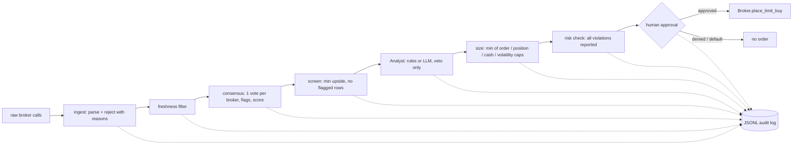

# quant-agents

Agent workflows for equity research: turn messy broker calls into a risk-checked, human-approved list of order proposals. Pure Python standard library, 23 tests, no network access.

## Why this exists

Public broker-call roundups are noisy. Building a research agent on top of them surfaced real data problems, and each one became a design decision here:

| Problem seen in real data | How the pipeline handles it |
|---|---|
| A target of Rs 377 against a price of Rs 138 (about 170% "upside") looks like a unit or price mismatch | Medians above 120% upside are flagged `implausible-upside` and score 0 |
| One broker's headline number gets treated as "the market view" | One vote per broker (latest call wins); `single-broker` flag; score weights breadth and agreement |
| Calls with no price printed | `no-price` flag; never guessed |
| Mixed Buy/Sell views behind a high average | `has-sell` and `high-dispersion` flags; the analyst step vetoes them |
| Stale articles recycled as news | Freshness filter before scoring |
| Agents that can trade by accident | Pipeline only *proposes*; approval gate denies by default |

## Architecture



Key rules, enforced by tests:
- An analyst (including an LLM-backed one) can veto a candidate but cannot raise a size.
- Sizing returns the smallest applicable cap, so no heuristic can exceed a limit.
- The backtest signal sees only prior-day prices (no look-ahead), and costs are charged on exposure changes.
- Capital is reserved across proposals in one run, so later proposals see less cash.

## Try it

```bash
pip install -e ".[dev]"
pytest                                   # 23 tests
quant-agents consensus data/sample_broker_calls.txt --today 2026-10-14
quant-agents propose   data/sample_broker_calls.txt --today 2026-10-14 --audit audit.jsonl
quant-agents backtest                    # seeded synthetic prices
```

Output on the bundled **synthetic** sample (fictional companies):

```
ticker     brokers  buy%  upside%   score  flags
ALPHAPWR         3   100       71    51.2
BETAHOME         2   100       53    38.9
GAMMAHOT         1   100       51    31.8  single-broker
EPSILONBK        2    50        2     0.5  has-sell
DELTAFIN         1   100      174     0.0  single-broker,implausible-upside
ZETAMOTO         1   100      n/a     0.0  single-broker,no-price
```

Only `ALPHAPWR` and `BETAHOME` become proposals, each capped at 5% of a 3,800 portfolio.

## Limits (read before trusting any number)

- The sample data and the backtest prices are synthetic. The backtest demonstrates a correct engine, not a trading edge, and says so in its output.
- The consensus score is a transparent heuristic, not a fitted model. It has not been validated against realized returns; doing that needs a history of calls and outcomes.
- Broker targets are typically 12-month views and are often wrong. This is research tooling, not financial advice.
- `Broker` is an interface only. No brokerage integration is included.

## Layout

```
src/quant_agents/
  models.py     dataclasses (BrokerCall, ConsensusRow)
  ingest.py     parser with explicit rejection reasons
  consensus.py  aggregation, flags, scoring
  risk.py       policy, sizing, order checks
  backtest.py   engine + metrics
  workflow.py   pipeline, approval gate, audit log
  cli.py        command-line entry point
tests/          unit + workflow tests
```

## Next steps

- Join calls to realized price paths to measure whether consensus score predicts returns (walk-forward, with costs).
- LLM-backed `Analyst` that summarizes the thesis behind each call, with the veto-only constraint kept.
- Adapter for a real brokerage API behind the `Broker` interface, with order-status reconciliation.
