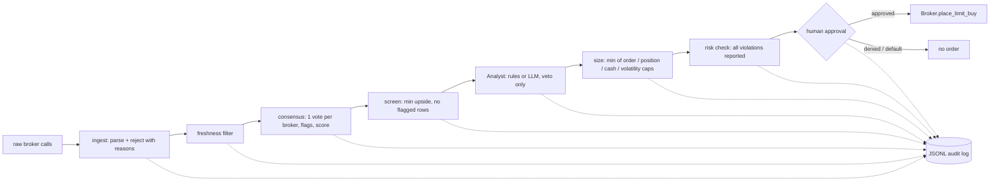

# quant-agents

Agent workflows for equity research: turn messy broker calls into a risk-checked, human-approved list of order proposals. No runtime dependencies (standard library only; `pypdf` is optional for reading PDFs). It touches the network only when you run `nse-tools` or `skillwatch`; everything else works on local files.

## Why this exists

Public broker-call roundups are noisy. Building a research agent on top of them surfaced real data problems, and each one became a design decision here:

| Problem seen in real data | How the pipeline handles it |
|---|---|
| A target of Rs 377 against a price of Rs 138 (about 170% "upside") looks like a unit or price mismatch | Medians above 120% upside are flagged `implausible-upside` and score 0 |
| One broker's headline number gets treated as "the market view" | One vote per broker (latest call wins); `single-broker` flag; score weights breadth and agreement |
| Calls with no price printed | `no-price` flag; never guessed |
| A Buy whose target is below the current price (or a Sell above it) | `rating-target-mismatch` flag; score 0, because the pair is contradictory and probably stale or mistyped |
| Mixed Buy/Sell views behind a high average | `has-sell` and `high-dispersion` flags; the analyst step vetoes them |
| Stale articles recycled as news | Freshness filter before scoring |
| Agents that can trade by accident | Pipeline only *proposes*; approval gate denies by default |

## Architecture



Key rules, enforced by tests:
- An analyst (including an LLM-backed one) can veto a candidate but cannot raise a size.
- Sizing returns the smallest applicable cap, so no heuristic can exceed a limit.
- The backtest signal sees only prior-day prices (no look-ahead), and costs are charged on exposure changes.
- Capital is reserved across proposals in one run, so later proposals see less cash.

## Try it

```bash
pip install -e ".[dev]"
make check                               # lint, types, tests, smoke, coverage (see Makefile)
quant-agents consensus data/sample_broker_calls.txt --today 2026-10-14
quant-agents propose   data/sample_broker_calls.txt --today 2026-10-14 --audit audit.jsonl
quant-agents backtest                    # seeded synthetic prices
```

Output on the bundled **synthetic** sample (fictional companies):

```
ticker     brokers  buy%  upside%   score  flags
ALPHAPWR         3   100       71    51.2
BETAHOME         2   100       53    38.9
GAMMAHOT         1   100       51    31.8  single-broker
EPSILONBK        2    50        2     0.5  has-sell
DELTAFIN         1   100      174     0.0  single-broker,implausible-upside
ZETAMOTO         1   100      n/a     0.0  single-broker,no-price
```

Only `ALPHAPWR` and `BETAHOME` become proposals: with the default 3,800 portfolio each is capped at 5%, which is Rs 190.

## Use it on real broker reports (Indian market)

Download research PDFs from any free source (broker sites, Economic Times, Moneycontrol, exchange filings) into one folder, named `TICKER__BROKER__YYYY-MM-DD.pdf`, then:

```bash
pip install -e ".[pdf]"
quant-agents extract reports/ > calls.txt     # refuses ambiguous reports and says why (stderr)
quant-agents consensus calls.txt              # flags, scores
quant-agents propose   calls.txt --audit audit.jsonl
```

The extractor reads only the first pages, understands Indian wording (Accumulate, Add, Reduce, Neutral), and refuses reports with conflicting ratings or multiple targets. An ambiguous price is left unknown, never guessed.

## Do broker targets actually predict returns? (`validate`)

Given past calls and a price CSV (`ticker,date,close`), `quant-agents validate calls.txt prices.csv --horizon 180` enters the day *after* publication, scores only finished windows, and reports hit rate, how much targets overstated realized returns, rank IC, a permutation p-value, and realized return by implied-upside tercile.

Harness self-check on **simulated** worlds (150 stocks, 180-day horizon), which shows the method works and says nothing about real brokers:

| World | mean implied | mean realized | hit rate | rank IC | p-value |
|---|---|---|---|---|---|
| targets are noise | 40.9% | 2.7% | 22% | +0.054 | 0.254 (not significant) |
| planted edge | 40.9% | 28.0% | 43% | +0.431 | 0.000 |

Unit tests also check there is no look-ahead (a price spike on the publication day is ignored) and that the false-positive rate on noise stays near the nominal level.

## Scenario desk on NSE data (official MCP servers)

NSE publishes official MCP servers ([nseindia.com/nse-mcp](https://www.nseindia.com/nse-mcp)): a **bhavcopy** server (end-of-day history, per NSE about five years) and a **CM market** server (near-live snapshots, roughly 1-3 minutes delayed per third-party write-ups). `quant_agents.nse.McpClient` speaks streamable HTTP to them and the tool schemas are discovered at run time, never hard-coded:

```bash
quant-agents nse-tools                     # prints the real tool names and input schemas
quant-agents scenarios bhav_csvs/ --weights RELIANCE=0.4,INFY=0.3,HDFCBANK=0.3 --value 3800
```

What the scenario engine runs on a portfolio (all from bhavcopy history):

| Scenario | Output |
|---|---|
| Historical stress | Worst 1-day and 20-day windows, 1-day VaR95 / CVaR95, annualised vol |
| Corporate actions | Bhavcopy's previous close is adjusted by NSE, so `close/prev_close` returns stay clean; days where it differs from the prior close are flagged (a 1:5 split shows raw -80% vs adjusted ~0%) |
| Market shocks | Portfolio P&L for -5/-10/-20% market moves using each stock's beta (market proxy = equal-weight of the loaded universe, not the Nifty) |
| Bootstrap | Probability of breaching the 15% drawdown halt over N days, and 5th-percentile return (block bootstrap) |
| Regimes | Strategy metrics split by bull / sideways / bear market regime |
| Liquidity | Days to exit each position at 10% of average daily traded value |

Demo on **synthetic** bhavcopy files with a planted split and a planted -12% crash:

```
days analysed=300 | annualised vol 12.7%
1-day VaR95 1.25% | CVaR95 1.67%
worst 1-day: 2026-07-20 -4.0%   (the planted crash, at a 30% weight)
over 60 days: P(drawdown > 15% halt) = 0.7%; 5th-percentile return -7.9%
market-shock P&L: -5%: -4.9%, -10%: -9.8%, -20%: -19.7%
corporate action? GAMMA 2026-05-31: raw -80% vs adjusted -0.2%
```

**Not yet verified against NSE:** the client is tested only against a local fake MCP server (JSON and SSE responses, session id echo). The sandbox this was built in could not reach NSE's hosts, so run `quant-agents nse-tools` first on an open network and confirm the tool names and columns. NSE's page states that MCP data confers no right to train or fine-tune AI models: scenario testing is not model training, but read the terms and do not redistribute the data.

Solace Agent Mesh (open source, MCP and A2A support) is one way to host a multi-agent desk around these tools; nothing here depends on it.

## Other markets: Hong Kong and Korea loaders (started)

`markets.py` loads HKEX and KRX files through a **spec**, not a hard-coded layout, because I could not verify either
exchange's current file schema from this sandbox. HKEX's free daily quotations are published as web pages (historical
CSV is a paid product, and no official MCP server was found); KRX Data Marketplace offers CSV/Excel downloads and an
Open API that needs an AUTH_KEY. What the loaders do:

- **Column mapping with a verifier.** Candidate English, Korean and KRX-style API names per field (marked unverified).
  `quant-agents markets-verify FILE --market krx|hkex [--map close=종가]` shows what mapped, what did not, and where the
  previous close will come from. A file whose close or symbol cannot be mapped is refused with the column list.
- **Real-world conventions.** cp949 decoding for Korean files (refuses to guess an encoding), zero-padded codes (HK 5
  digits, KRX 6), `N/A` or `-` rows as suspended (never zero), thousands separators, and the trade date taken from the file
  name when a per-day download has no date column.
- **Previous close is the hard part.** NSE adjusts it for corporate actions; these files may not. Each bar records its basis
  (`exchange`, `derived_from_change`, `raw_previous_close`, `adjusted_by_actions`). `corporate.unadjusted_jumps` flags moves
  beyond KRX's +/-30% limit (or a threshold for HK, which has no fixed limit), and `apply_actions` fixes returns once you
  supply split ratios from exchange notices. The ratio is never inferred from the jump.
- **Works with the rest:** `scenarios --market krx|hkex` runs the stress report on these files (the output is currency-neutral
  returns); `avg_traded_value` replaces the rupee-crore helper for other currencies.

Not done yet: live API clients (HKEX programmatic download, KRX Open API), tick sizes and board lots, trading calendars and
holidays, segment/liquidity thresholds in local currency, and any validation against real files. Treat the alias lists as
a starting point and run `markets-verify` on the first real file before trusting results.

## Keeping the skill current

`docs/GAP_ANALYSIS.md` compares this project with 15 public skills and frameworks (global, India, China, emerging
markets) and records what was adopted, what was deliberately skipped, and what is still open. `quant-agents skillwatch`
re-checks those repos for new or changed skills and writes a dated digest in `watch/`; it never changes our code.

Also added from that review: fundamental quality scores (`fundamentals.py`: Piotroski, Altman Z'', Beneish M),
valuation with reverse DCF (`valuation.py`), a thesis tracker (`thesis.py`), a pre-trade discipline gate and loss
circuit breaker (`discipline.py`), market breadth and sector strength (`breadth.py`), an exposure ceiling
(`posture.py`), liquidity impact (`liquidity.py`), staged entries (`ladder.py`), an India capital-gains estimator
(`tax.py`, rates must be confirmed) and event-risk caveats (`events.py`). `paper-review` gives a post-mortem of closed paper trades.

## Segment and sector aware screening (large / mid / small / micro)

A plain consensus rule ("at least two agreeing brokers") quietly excludes small and micro caps, which usually have one analyst or none, so every list drifts to large caps. `propose --universe` keeps the safety goal but changes the gate by size:

| Segment | Brokers needed | Max per order | Extra gates |
|---|---|---|---|
| Large | 2 | 5% | none |
| Mid | 2 | 4% | liquidity floor |
| Small | 1 (flagged "thin coverage") | 2% | liquidity floor, promoter pledge and debt/equity evidence |
| Micro | 1 (flagged) | 1% | lower absolute liquidity floor (Rs 0.25 crore a day, against Rs 1 crore for small) because positions are capped at 1%; same evidence |

The liquidity floors are flat rupee amounts, not scaled to your position size, so a large portfolio should set its own. Small and micro positions share a 10% slice, and no sector may exceed 30% of the portfolio. Candidates that cannot be verified are never proposed: if the only blockers are missing inputs they appear under **PENDING DATA** with the exact fields needed; otherwise under **DID NOT QUALIFY**. Valid names that exceed the daily order limit are **QUEUED**, not dropped.

```bash
quant-agents propose calls.txt --universe universe.csv --bhavcopy bhav_csvs/ --cash 100000
```

`universe.csv` columns: `ticker, sector, segment` (or `amfi_rank`), optional `adv_value_cr, promoter_pledge_pct, debt_to_equity`. Liquidity can be filled from bhavcopy. Segments follow AMFI ranks (1-100 large, 101-250 mid, 251+ small; "micro" beyond rank 500 is a common but unofficial label). The thresholds are starting assumptions, not tested optima. Nothing infers a company's size, liquidity or pledge: blank means unknown.

## Paper trading: prove it before risking money

`paper-enter` / `paper-exit` record would-be trades in an append-only ledger. Fills happen at the first close *after* the decision day (no look-ahead), with slippage and Indian delivery costs (`CostModel`; defaults are approximations, set them from your contract note). `paper-report` compares the result with a benchmark index fund bought on the same day with the same costs, and refuses to give a verdict until there are at least 60 days and 20 trades.

```bash
quant-agents paper-enter ledger.json --ticker RELIANCE --amount 5000 --day 2026-10-15 --prices prices.csv --cash 100000
quant-agents paper-report ledger.json --prices prices.csv --benchmark NIFTYBEES
```

A flat trade loses money after round-trip costs (tested), which is the point: an agent has to beat friction *and* the index.

## Pre-market global cues

`quant-agents briefing cues.json` turns overnight moves in Nikkei, Hang Seng, KOSPI, Straits Times, GIFT Nifty, US futures, USD/INR, Brent, India VIX, US yields and FII flow into a tone score with every contribution shown. Missing or stale inputs are excluded and listed, coverage under 50% refuses a label, and headline keywords (RBI, Fed, tariff...) are flagged for a human, not scored. The weights are judgment, not fitted: `validate-tone` (CSV of `tone,nifty_return`) tests whether the tone predicted the session's move, with a permutation p-value. See `data/sample_cues.json` (synthetic values) for the input format; nothing in this repo fetches the data.

## Exchange feeds: what exists (NSE and BSE)

| | NSE | BSE |
|---|---|---|
| Official MCP server | Yes: bhavcopy (history) and CM market (near-live), no auth per NSE's page | None found; only third-party MCP projects (unvetted; one carries a "review recommended" security score) |
| Official history | Bhavcopy, about five years via MCP | Bhavcopy files, now in the standard UDiFF format; some older files were discontinued from 8 Jul 2024 |
| Official live data | CM market MCP, roughly 1-3 min delayed (third-party write-up) | Licensed "Self Data Feed" (KYC, agreement, fees per third-party guides); real-time/redistribution needs BSE onboarding |
| Status in this repo | Client and parser built; not run against live servers | Bhavcopy parsing (UDiFF and legacy); no live adapter |

Because both exchanges publish official bhavcopy, `crosscheck` gives a two-source price check straight from the exchanges, joined by ISIN:

```bash
quant-agents crosscheck nse_csvs/ bse_csvs/    # exit code 1 if any close or return disagrees
```

It flags closes that differ by more than a tolerance (default 1%), and daily returns that differ by more than 1 percentage point, which catches an exchange that failed to adjust for a split. Rows without an ISIN are reported, never matched by name. Not yet confirmed against real files: that BSE's UDiFF columns match NSE's names, and whether BSE's previous close is corporate-action adjusted (check the UDiFF guidance on bseindia.com before relying on BSE returns).

## Plug into AI Hedge Fund

`integrations/ai_hedge_fund/india_broker.py` adds an `india_broker` analyst to [virattt/ai-hedge-fund](https://github.com/virattt/ai-hedge-fund) (MIT) through its own `AlphaModel` interface and registry, with no fork needed. It is point-in-time, uses one vote per broker, returns a bounded conviction in [-1, 1], and abstains on thin or implausible data.

```bash
export QUANT_AGENTS_CALLS=calls.txt
PYTHONPATH=src:integrations/ai_hedge_fund:/path/to/ai-hedge-fund python -c "import india_broker; india_broker.register()"
```

Tested against the fund's real `AlphaModel` and `Signal` classes (fund checkout at commit `78b779c`).

## Prior art and what was reused

Surveyed public GitHub projects before extending this one (the full comparison is in `docs/GAP_ANALYSIS.md`):

| Project | What it is | Used here |
|---|---|---|
| [vishalmdi/india-equity-report-skill](https://github.com/vishalmdi/india-equity-report-skill) (MIT) | Prompt-only skill for NSE/BSE reports | The *discipline*, rewritten as code: two-source price cross-check, staleness limits, and a `[Source: ...]` coverage audit (`quality.py`). No text copied. Its benchmark is a self-run qualitative comparison, so its claims are not independently validated. |
| [virattt/ai-hedge-fund](https://github.com/virattt/ai-hedge-fund) | Investor-persona agents with a risk and portfolio manager (widely used) | MIT-licensed (LICENSE file read). Used as a design reference for the analyst/risk/portfolio split, and `integrations/` is tested against its `AlphaModel` and `Signal` classes. US-focused; the rest of its code was not audited. |
| [TauricResearch/TradingAgents](https://github.com/TauricResearch/TradingAgents) | Debate-style multi-agent trading framework | Reference only; its license and code were not audited. |

`skills/india-equity-check/SKILL.md` packages the workflow as a Claude skill that calls these tools instead of trusting free-text numbers.

## Limits (read before trusting any number)

- The sample data and the backtest prices are synthetic. The backtest demonstrates a correct engine, not a trading edge, and says so in its output.
- The consensus score is a transparent heuristic, not a fitted model. It has not been validated against realized returns; doing that needs a history of calls and outcomes.
- Broker targets are typically 12-month views and are often wrong. This is research tooling, not financial advice.
- `Broker` is an interface only. No brokerage integration is included.

## Layout

```
src/quant_agents/
  models.py        BrokerCall and ConsensusRow dataclasses
  ingest.py        broker-call parser with explicit rejection reasons
  pdf_extract.py   conservative extractor for broker reports (text or PDF)
  consensus.py     one vote per broker, flags, scoring
  quality.py       two-source price check, staleness, source-tag audit
  fundamentals.py  Piotroski, Altman Z'', Beneish M
  valuation.py     DCF, reverse DCF, Graham number, margin of safety
  thesis.py        thesis tracker with invalidation conditions
  risk.py          limits, sizing, stop-based and Kelly sizing
  discipline.py    pre-trade gate, loss circuit breaker, journal
  posture.py       exposure ceiling from tone and breadth
  segmented.py     size- and sector-aware screening and sizing
  universe.py      segment, sector, liquidity and evidence metadata
  events.py        event-risk calendar
  ladder.py        staged entries
  liquidity.py     price impact and Amihud illiquidity
  tax.py           India capital-gains estimate (confirm the rates)
  backtest.py      backtest engine and metrics
  validation.py    do broker targets predict returns?
  scenarios.py     stress, shocks, bootstrap, regimes, replay, correlation spike
  breadth.py       market breadth and sector strength
  papertrade.py    paper ledger, benchmark report, post-mortem
  cues.py          global-cues tone score and its validation
  nse.py           NSE/BSE bhavcopy parser and MCP client
  crosscheck.py    NSE vs BSE agreement check, joined by ISIN
  markets.py       spec-driven HKEX and KRX loaders and verifier
  corporate.py     corporate-action jump detection and ratio-based fixes
  workflow.py      pipeline, approval gate, audit log
  skillwatch.py    watches reference skill repos for changes
  cli.py           command-line entry point
integrations/      AI Hedge Fund adapter
skills/            Claude skill wrapping the workflow
docs/              gap analysis versus other public skills
data/              synthetic samples and the watchlist
watch/             skillwatch state and dated digests
tests/             unit, property, smoke, regression and docs-consistency tests
Makefile           `make check` runs every gate
```

## Command reference

| Command | What it does |
|---|---|
| `consensus` | score broker calls from a file |
| `propose` | risk-checked proposals; add `--universe` for size and sector rules |
| `extract` | turn a folder of broker reports into call lines |
| `validate` | did past targets predict later returns? |
| `backtest` | momentum versus buy-and-hold on seeded synthetic prices |
| `nse-tools` | list an MCP server's tools (needs network access) |
| `scenarios` | stress-test a portfolio on daily price files (`--market nse|hkex|krx`) |
| `markets-verify` | check how a real HKEX or KRX file maps onto our fields |
| `crosscheck` | compare NSE and BSE bhavcopy folders |
| `paper-enter`, `paper-exit` | record paper trades (fills at the next close) |
| `paper-report` | paper results versus a benchmark, after costs |
| `paper-review` | post-mortem of closed paper trades |
| `briefing` | pre-market global-cues tone from a JSON file |
| `validate-tone` | did the tone predict the market's move? |
| `skillwatch` | check the reference skill repos for changes |

Run `quant-agents <command> --help` for every option, with units and defaults.

## Quality gates

Full description, mutation-testing numbers and known gaps: [docs/TESTING.md](docs/TESTING.md).

`make check` runs, in order: ruff (lint), mypy (types), the full pytest suite, smoke tests that execute every CLI command in a
subprocess, golden-output regression tests, property-based tests (hypothesis), and a coverage report. `make mutate` runs a
mutation test over the risk-critical modules: it deliberately breaks the code in small ways and checks that the tests notice.
The AI Hedge Fund adapter tests run only when a checkout is on `PYTHONPATH` and are skipped otherwise.

## Next steps

- Run `validate` on a real history of Indian broker calls (hundreds of calls across at least a year, adjusted prices) to learn whether consensus score has any predictive value. Not yet done: this needs data the sandbox cannot download.
- LLM-backed `Analyst` that summarizes the thesis behind each call, with the veto-only constraint kept.
- Adapter for a real brokerage API behind the `Broker` interface, with order-status reconciliation.
